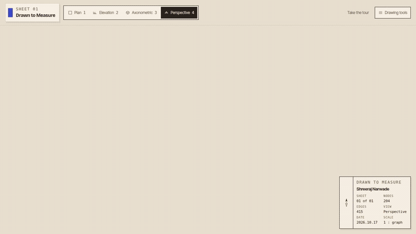

# Drawn to Measure

A three dimensional drawing of Shreeraj Narwade, where the graph is the data and nothing in the scene is invented.



## Live demo

There is no live demo yet. Run the drawing locally with the command below.

## Run

```bash
npm install && npm run dev
```

Then open http://localhost:8080.

`npm run build` writes the static site.

## Replace the graph

1. Export a new NetworkX node link file from Graphify.
2. Save it as `src/data/graph.json`. Keep `nodes`, `links`, and `hyperedges`.
3. Rebuild the frozen layout:

```bash
node scripts/build-layout.mjs
```

The layout uses a fixed seed, so the drawing is the same on every load until you run that script again.

## Checks

```bash
node --experimental-strip-types scripts/check-dashes.ts
```

That script fails if an em dash or en dash appears in a shipped file.

## Keys

- Drag to orbit, right drag to pan, scroll to zoom toward the cursor.
- 1 plan, 2 elevation, 3 axonometric, 4 perspective.
- F to walk through the drawing. WASD moves. Shift is faster. Esc leaves.
- Slash or Cmd K searches. Double click empty sheet returns to the overview.
